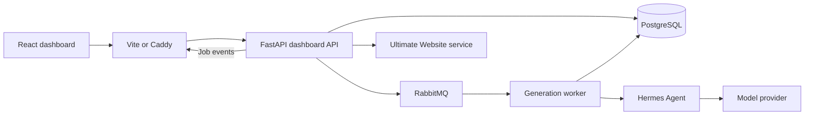

# System architecture

The browser sends authenticated requests to its own origin. FastAPI checks the user's session, submits generation jobs and streams job status updates. The worker applies the project’s generation steps and saves their outputs in PostgreSQL. [Deployment and configuration](https://github.com/shrubnetllc/anvil-api/blob/main/dashboard.md)
